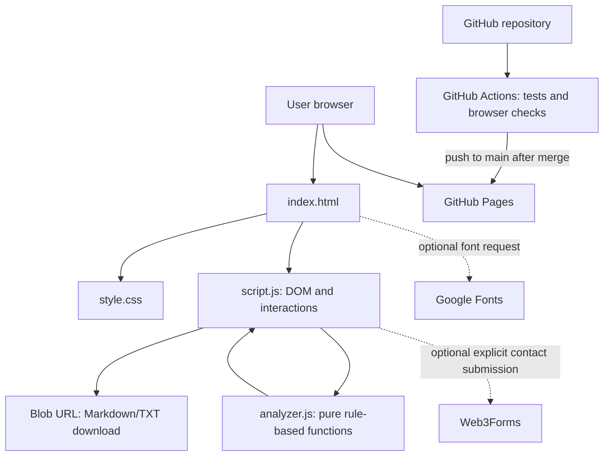

# HireSense architecture

## Decision summary
Use a static, client-side application. A backend, database, authentication provider, job queue, payment processor, and API are deliberately absent because the current core workflow requires none of them.

## Component diagram

## Stack
- HTML, CSS, vanilla JavaScript; no frontend build step.
- `analyzer.js` owns deterministic analysis/report functions.
- `script.js` owns DOM interactions, rendering, and downloads.
- Node.js built-in test runner for unit tests.
- Playwright + Chromium for browser smoke and accessibility tests.
- GitHub Pages for static hosting; GitHub Actions for CI/CD.

## Alternatives considered
- Full-stack framework + managed database/auth: rejected for current scope because there is no account or server-persisted workflow. It would add cost, secrets, migrations, and operational risk without solving a current requirement.
- LLM-backed resume review: rejected for this iteration because it would transmit sensitive text to a provider and require server-side secret management, cost controls, and explicit privacy disclosure.
- Server-side file storage: rejected because the current workflow can operate on pasted text locally.
- Payments: disabled until a server-side verified entitlement model exists.

## Boundaries and data flow
1. The browser loads static HTML/CSS/JS.
2. Resume text is passed to pure local analysis functions.
3. Results are rendered in the same browser and may be downloaded as a Blob.
4. The optional contact form is a separate third-party boundary and must only transmit fields after explicit submission.
5. No resume data should be included in analytics, server logs, issue reports, or telemetry.

## Dependencies
- Runtime: no npm runtime dependencies.
- Test-only: Node.js built-in test runner and Playwright installed in CI. The accessibility audit uses axe-core as a test-only tool.
- External services: GitHub Pages, Google Fonts (optional), Web3Forms (contact form only, if configured).

## Three main risks
1. **Privacy / third-party form boundary:** form values are sent outside the page if the user submits the contact form. Keep this separate from resume analysis and clearly disclose it.
2. **Heuristic overclaiming:** a score or term-overlap percentage could be misunderstood as ATS compatibility. Keep limitations visible in the UI and report.
3. **Client-side security:** user text must not be inserted as executable HTML. Use textContent/DOM nodes and test malicious-looking input.

## Operations
- CI validates each pull request.
- GitHub Pages deployment runs only on pushes to `main` or manual dispatch.
- Rollback is performed by reverting the deployment commit and redeploying, or selecting a prior deployment artifact where supported.
- No server health endpoint is applicable to a static site; verify the deployed URL and critical workflows instead.
